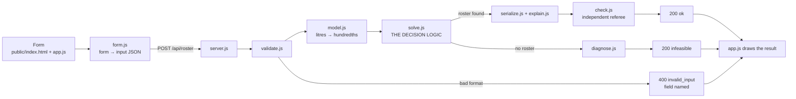

# HackApex-Intra-Hackathon

# Who Stays On?


[](https://hackapex-intra-hackathon-6d7w.onrender.com/)


**Generator rosters for load-shedding days: provably the best plan, with a reason for every shop that stays dark.**

   

Shapla Shopping Complex has one 20 kW generator, 17 litres of diesel and twelve shops that together want almost 40 kW. On a load-shedding day someone has to decide, for every hour without grid power, which shops stay on.

Who Stays On? makes that decision for the whole day at once. Its roster:

- never overloads the generator;
- never runs out of diesel;
- keeps the pharmacy's insulin fridge and the ATM on in every outage hour;
- never leaves another shop dark for more than the allowed number of hours in a row;
- serves the most value possible within those rules, and proves it.

Every dark hour gets a reason with real numbers. When no roster can keep every rule, the app says which rule fails and by how much, for example *"needs at least 17.60 L of diesel; the budget is 17.00 L, 0.60 L short"*.


---

## Contents

- [Quick start](#quick-start)
- [Results at a glance](#results-at-a-glance)
- [Using the screen](#using-the-screen)
- [Screenshots](#screenshots)
- [Architecture](#architecture)
- [How the solver decides](#how-the-solver-decides)
- [API](#api)
- [Rules the app enforces](#rules-the-app-enforces)
- [Explanations and impossible days](#explanations-and-impossible-days)
- [Testing and verification](#testing-and-verification)
- [Evidence: bugs we found and fixed](#evidence-bugs-we-found-and-fixed)
- [Project structure](#project-structure)
- [Known limitations](#known-limitations)
- [Development history](#development-history)
- [Further documents](#further-documents)

---

## Quick start

**Requirements:** Node.js 20 or newer (developed and tested on 22.22). There are no dependencies, so there is no `npm install` step.

```bash
git clone <this repository>
cd who-stays-on
npm start
```

Open **http://localhost:3000** and click **Load the sample (Shapla, Thursday)**.

| Task | Command |
|---|---|
| Start the app (screen + API) | `npm start` (port 3000; `PORT=8080 npm start` to change) |
| Run the automated tests | `npm test` |
| Solve a file from the terminal | `node src/cli.js inputs/sample_input.json` |
| Regenerate the committed outputs (server running) | `sh outputs/make.sh` |
| Replay the evidence through the API (server running) | `sh evidence/run.sh` |
| Random stress test (takes minutes) | `node tools/fuzz.js 777 150` |

Nothing loads from the internet at runtime, not even fonts.

<details>
<summary>Installing Node.js on Ubuntu, if <code>node -v</code> is missing or older than 20</summary>

```bash
curl -fsSL https://deb.nodesource.com/setup_22.x | sudo -E bash -
sudo apt-get install -y nodejs
```

Ubuntu's own `nodejs` package is usually too old.
</details>

---

## Results at a glance

| Input | Result | Time on our machine |
|---|---|---|
| The brief's worked example | Value **84** using exactly **8.00 L**, matching the published answer | under 0.1 s |
| Official sample (`inputs/sample_input.json`) | Value **186** using **16.40 of 17.00 L**, **proven best** | about 0.6 s |
| Sample with 16:00 also an outage (a likely minute-150 change) | **Infeasible:** needs at least 17.60 L | under 0.5 s |
| Same, with a 17.60 L budget | OK, value 185, uses exactly 17.60 L | under 0.5 s |
| 300 random full-size markets (stress test) | 299 proven best, 1 labelled "not proven" | slowest 6.7 s |

The brief's limit is 10 seconds per input.

---

## Using the screen

The screen is a form, so nobody needs to write JSON.

1. **Load the sample (Shapla, Thursday)** fills the form with the official sample and generates its roster. **Clear form** empties every field.
2. Fill in or change the four sections:
   - **A. Generator:** capacity (kW), diesel budget (litres, at most two decimals), and the most hours in a row a normal shop may be dark.
   - **B. Grid schedule:** ten buttons, 10:00 to 19:00. Press an hour to switch it between **grid** (mains power, nothing to plan) and **outage** (the generator decides).
   - **C. Fuel table:** "up to this many kW costs this many litres per hour". Rows can be added or removed; the last load must equal the capacity.
   - **D. Shops:** ID, kW, type (normal, or mandatory ★) and a value for each of the ten hours. Up to 12 shops.
3. Press **Generate roster**. The result is one of:
   - **OK** (green): the roster board, totals, charts and a reason on every ✗.
   - **Infeasible** (amber): which rule cannot be met, with numbers, plus a best-effort roster clearly marked *NOT a valid roster*.
   - **Invalid input** (red): the server names the bad field and the form outlines it. Nothing is computed.


*The input form with the official sample loaded: generator, grid schedule (amber = outage), fuel table, and shops (★ highlighted rows are mandatory).*


*Pressing Generate on an empty form: nothing is sent; every missing field is listed and outlined.*

4. **Download output JSON** saves the exact API answer. **Print roster** gives one A4 page for the generator-room door.
5. **JSON import and export** (optional): fill the form from a JSON file or pasted text, or save the form as the JSON request.

What the result shows:

- **Status chip:** OK · proven best, Infeasible, or Invalid input.
- **Key numbers:** value served, diesel used vs budget (and what is left), peak load vs capacity, outage hours, total dark shop-hours.

  

- **Charts:** generator load per hour against capacity, and diesel used so far against the budget.

  

- **Roster board:** one row per shop, one column per hour; ✓ powered, ✗ dark with a reason letter (D diesel, C capacity, B too big, N never fits, Z no gain, L least-diesel plan), grey "grid" for mains hours, ★ for mandatory shops; footer rows for load, diesel per hour and running total.

  

- **Why each shop is dark:** every reason in full, filterable by type. Clicking a ✗ jumps to its reason.

  

| Infeasible day | Invalid input |
|---|---|
|  |  |

---

## Screenshots

| One-page A4 print (for the generator-room door) |
|---|
|  |

| Phone width (390 px) | Dark mode |
|---|---|
|  |  |

---

## Architecture




Only `solve.js` makes decisions; every other step prepares, checks, explains or shows. The screen never computes a roster: it sends the same request any other market's system could send, and draws the answer.

| Step | File | Job |
|---|---|---|
| Screen | `public/index.html`, `app.js`, `styles.css` | Form, status, numbers, charts, board, reasons, download, print |
| Form converter | `public/form.js` | Form ↔ input JSON; blocks only empty or non-numeric fields |
| HTTP server | `src/server.js` | `POST /api/roster` and the screen's files; Node built-ins only |
| Pipeline | `src/solver/index.js` | Runs the steps in order; chooses HTTP 200 / 400 / 500 |
| Validation | `src/solver/validate.js` | Format rules; names the bad field |
| Model | `src/solver/model.js` | Litres → whole hundredths, outage hours, fuel lookup |
| **Solver** | **`src/solver/solve.js`** | **The decision logic** (read the comment at the top first) |
| Reasons | `src/solver/explain.js` | One reason with numbers per dark shop per hour |
| Impossible days | `src/solver/diagnose.js` | Which rule fails, by how much, best-effort roster |
| Output | `src/solver/serialize.js` | Builds the JSON; recomputes every total from the roster |
| Referee | `src/solver/check.js` | Re-checks every rule; shares no code with the solver |

---

## How the solver decides

Powering the most valuable shops hour by hour fails, as the brief warns: it spends the diesel at noon and starves the same cheap shop until the three-hour rule breaks. Who Stays On? plans the whole day as one plan.

**The model.** For each shop *s* and outage hour *t*, decide *x(s, t)* = on or off, to

- **maximise** the total value served over outage hours (mandatory shops included), subject to
- **capacity:** the powered shops' kW in each hour ≤ generator capacity;
- **diesel:** the sum over hours of *fuel(combined load)* ≤ budget, where *fuel* is the first fuel-table level at or above the load, and zero load costs zero;
- **mandatory:** every mandatory shop is on in every outage hour;
- **dark runs:** a normal shop is dark at most *K* outage hours in a row; a grid hour resets the count.

**The method: an exact layered dynamic programme.**

1. **State.** The only thing the past forces on the future is how long each normal shop has been dark. That vector of dark runs is the state (up to 3¹⁰ = 59,049 states for the sample).
2. **Pareto labels.** For each state, keep every plan that is not beaten on both value and diesel. A plan is dropped only if another plan at the same state has at least as much value and no more diesel, so the best plan is never lost.
3. **Transitions.** Each hour, try every group of shops that includes all shops already dark *K* hours, fits beside the mandatory shops, and is **"full" for its fuel level**. If a shop still fits without moving to a dearer fuel level, adding it costs no diesel and only helps, so the best plan never leaves it out. This cuts 444 valid groups per hour to 148 in the sample.
4. **Order of work.**
   - A quick pass keeps the 300 most promising plans per hour and finds a good valid roster fast.
   - If it finds nothing, a least-diesel search, which drops any plan that can no longer finish within the budget, proves whether any roster exists.
   - The exact pass then searches everything that could still beat the best roster found, skipping branches with an optimistic bound (best value per hour at each fuel cost, ignoring the dark rule, combined by a small knapsack over the remaining diesel).
   - Finishing the exact pass proves the answer is the best: `"optimal": true`.
5. **Time guard.** After 6 s of search (plus a 0.7 s wider fallback), the best roster found is returned labelled `"optimal": false`. It is never presented as proven.

**Exact arithmetic.** All diesel is counted in whole hundredths of a litre, so 17.60 L passes and 17.59 L fails exactly as the rules say, with no floating-point surprises.

**Ties.** Equal-value rosters are equally good. Ties are broken by less diesel, then a fixed order, so the same input always gives byte-identical output.

---

## API

`POST /api/roster` takes the input JSON as the body and returns the output JSON. The screen uses this same endpoint.

```bash
curl -s -X POST -H 'content-type: application/json' \
     --data @inputs/sample_input.json http://localhost:3000/api/roster
```

**Input** (an excerpt of `inputs/sample_input.json`, which has twelve shops):

```json
{
  "grid_available": [true, true, false, false, false, false, true, false, false, false],
  "generator_capacity_kw": 20,
  "fuel_budget_litres": 17.0,
  "fuel_table": [
    { "load_kw": 7,  "litres_per_hour": 1.2 },
    { "load_kw": 14, "litres_per_hour": 2.0 },
    { "load_kw": 20, "litres_per_hour": 2.8 }
  ],
  "max_consecutive_dark": 2,
  "shops": [
    { "id": "pharmacy", "kw": 3, "type": "mandatory", "value_per_slot": [6,6,6,6,6,6,6,6,6,6] },
    { "id": "tailor_jamal", "kw": 4, "type": "normal", "value_per_slot": [2,2,3,3,4,4,4,4,5,5] }
  ]
}
```

**Responses:**

| Status | HTTP | Main fields |
|---|---|---|
| `ok` | 200 | `roster` (per outage hour: `slot`, `time`, `powered`, `dark` [{`id`, `reason`}], `load_kw`, `fuel_litres`, `fuel_running_litres`), `value_total`, `fuel_total_litres`, `dark_hours`, `capacity_kw`, `fuel_budget_litres`, `optimal` |
| `infeasible` | 200 | `message`, `conflicts` [{`rule`, `shops`, `slots`, `detail`}], `roster: []`, `best_effort` (labelled, or `null`), `proven` |
| `invalid_input` | 400 | `field` (e.g. `shops[3].kw`), `message` |
| error | 405 / 404 / 500 | wrong method, unknown path, or an internal check failure (a roster that breaks a rule is never sent) |

Example of one `ok` roster entry:

```json
{
  "slot": 3, "time": "13:00",
  "powered": ["pharmacy", "atm_booth", "mobile_shop", "grocery_fridge", "restaurant", "jewellery"],
  "dark": [{ "id": "tailor_jamal", "reason": "Capacity: 20 of 20 kW already in use at 13:00; adding 4 kW would make 24 kW. Dark 2 hours in a row so far (limit 2)." }],
  "load_kw": 20, "fuel_litres": 2.8, "fuel_running_litres": 4.8
}
```

The command-line tool `node src/cli.js <file>` runs the same pipeline and exits 0 for ok or infeasible, 1 for invalid input.

---

## Rules the app enforces

| Rule (from the brief) | Where |
|---|---|
| Slots 0–9 are 10:00–20:00; grid hours have no decision, no fuel, no value | `model.js` |
| At most 12 shops; unique non-blank IDs; whole positive kW; type mandatory or normal; ten whole values ≥ 0 | `validate.js` |
| Powered kW ≤ capacity in every outage hour; a shop bigger than the generator is never on | `solve.js` (`hourTable`), `check.js` |
| Fuel: first level ≥ combined load, charged once per hour; zero load = zero fuel; whole hundredths, no tolerance | `model.js` (`makeFuelFor`), `check.js` |
| Mandatory shops on every outage hour | `model.js`, `solve.js`, `check.js` |
| Dark runs ≤ `max_consecutive_dark`; grid hours reset; `dark_hours` counts every dark outage hour | `solve.js` (`forcedMask`), `check.js` |
| Maximise total value over outage hours | `solve.js` |
| Malformed input → `invalid_input` (400); valid but impossible → `infeasible` (200) | `validate.js`, `diagnose.js` |

---

## Explanations and impossible days

**Every dark shop, every hour.** The app imagines switching on only that shop and reports what breaks, with numbers:

| Code | Reason | Example |
|---|---|---|
| C | Capacity | "20 of 20 kW already in use at 13:00; adding 4 kW would make 24 kW" |
| D | Diesel | "lifts 12:00 from 14 to 18 kW (2.00 → 2.80 L/h, +0.80 L). The plan uses 16.40 of the 17.00 L budget, leaving 0.60 L spare…" |
| B | Too big | the shop is larger than the generator |
| N | Never fits | the shop cannot fit beside the mandatory shops |
| Z | No gain | the shop is worth 0 in that hour |
| L | Least-diesel plan | used in the best-effort roster of an impossible day |

Each reason also states the shop's current dark streak and the limit, e.g. *"Dark 2 hours in a row so far (limit 2)."*

**Impossible days.** The first failing check is reported with its numbers:


1. mandatory shops need more kW than the generator carries;
2. a shop that can never fit sits inside an outage longer than the dark limit;
3. the mandatory shops alone burn more diesel than the budget;
4. keeping every shop within the dark limit needs more diesel than the budget (exact minimum given, plus a best-effort roster marked *NOT a valid roster*);
5. at some hour, the shops that must come on cannot fit together.

---

## Testing and verification

```bash
npm test     # 39 tests, all passing (Node's built-in test runner)
```

| Test file | What it covers |
|---|---|
| `tests/solver.test.js` (8) | Worked example 84 / 8.00 L; sample 186; determinism; infeasible 16:00 case; empty days; **300 random markets compared with a brute-force solver**; reason numbers recounted from the roster |
| `tests/check_validate.test.js` (5) | The checker accepts the brief's published roster and catches broken copies; every invalid-input case names its field |
| `tests/audit.test.js` (7) | Fuel thresholds; capacity exactly full vs 1 kW over; dark-run limit and grid reset; more broken-roster and invalid-input cases; repeated requests on one server |
| `tests/api.test.js` (12) | Through real HTTP: sample, boundary 17.60 / 17.59, capacity and fuel infeasibility, oversized shops, K = 0 and K = 10, both bug regressions, adversarial input, 405 / 404 |
| `tests/form.test.js` (7) | The form converts to exactly the API input; strict number parsing; rule checks left to the server; add/remove rows; import refusals |

Beyond `npm test`:

- **Independent referee on every answer.** `check.js` imports nothing from the solver and re-checks every rule and total before an `ok` answer is sent.
- **Brute-force oracle** (`tools/brute.js`): tries every possible roster on small inputs; the solver matched it on 300 random markets.
- **Seeded stress test** (`tools/fuzz.js`): random twelve-shop markets; found a real bug (see below). It is a random sample, not an exhaustive proof.
- **Integer-programming cross-check** during planning (SciPy/HiGHS) agreed with our values: 84, 186, and infeasible for both likely minute-150 changes.
- **Browser checks** (headless Chromium, desktop and 390 px phone width, light and dark): 28 of 28 passed. They covered the empty form being blocked, the sample matching the API, a keyboard toggle leading to infeasible, a duplicate ID outlined, one request per double-click, download equal to the API answer, a one-page print, network-failure retry, and no sideways scroll.

---

## Evidence: bugs we found and fixed

All evidence runs against the real API: start the server, then `sh evidence/run.sh`. Details in [`evidence/README.md`](evidence/README.md).

| Folder | What broke | Before | After |
|---|---|---|---|
| `evidence/regression/` | All ten hours out with twelve small shops: the search kept tens of millions of plans | Commit `41cf264`: server **killed for using 5.9 GB of memory**, no answer | Value 403, proven best, about 2 s. Fixed with "full" groups, the optimistic bound, the least-diesel check and memory/time guards |
| `evidence/regression_timeout/` | A random stress test found a valid day the app got wrong | Commit `9c7adcb`: **"infeasible, not proven" after 21.2 s** (least diesel needed was only 12.93 L of 21.57 L) | Value 304, proven best, under 4 s. Fixed by running the quick pass first, checking the deadline inside each hour and adding a budget cut-off |
| `evidence/boundary/` | Boundary check, not a bug | — | Budget 17.60 L → OK, uses exactly 17.60 L; budget 17.59 L → infeasible, "0.01 L short" |

Both bugs are also automated regression tests in `tests/api.test.js`.

---

## Project structure

```
who-stays-on/
├── src/
│   ├── server.js            HTTP server: screen + POST /api/roster
│   ├── cli.js               same pipeline from the terminal
│   └── solver/
│       ├── index.js         pipeline: validate → model → solve → explain → check
│       ├── validate.js      input format rules
│       ├── model.js         hundredths, outage hours, fuel lookup
│       ├── solve.js         ★ the decision logic
│       ├── explain.js       reasons for dark shops
│       ├── diagnose.js      why a day is impossible
│       ├── serialize.js     output JSON (the only file that knows field names)
│       └── check.js         independent rule checker
├── public/                  the screen: index.html, app.js, form.js, styles.css
├── inputs/                  official sample (+ minute150_input.json when supplied)
├── outputs/                 our answers on the public inputs + make.sh
├── evidence/                regression and boundary evidence + run.sh
├── tests/                   npm test (39 tests)
├── tools/                   brute.js (oracle), fuzz.js (stress test)
└── docs/images/             architecture and screenshots for this README
```

---

## Known limitations

We list these openly; see [`KNOWN_ISSUES.md`](KNOWN_ISSUES.md) for the full table.

- **Official schema not supplied.** `schema.md`, `example_output.json` and the official validator were not in our pack. Output fields follow the brief's wording; if the official format differs, only `src/solver/serialize.js` changes.
- **Minute-150 output.** Save the official updated input as `inputs/minute150_input.json`, then run `sh outputs/make.sh` with the server running. Both likely changes (16:00 or 11:00 becoming an outage) need at least 17.60 L, so with 17.00 L they are infeasible.
- **One rule reading is unconfirmed.** A normal shop bigger than the generator, inside an outage longer than the dark limit, makes the day infeasible under our reading of rules 3 and 6.
- **Very hard inputs.** On 300 random hard markets, one answer was not proven best within the time guard; it is labelled `"optimal": false`. A machine much slower than ours could approach the 10 s limit.
- **Diesel reasons** give exact litres but do not name which other shop got the diesel; proving that needs a re-solve per dark cell.
- **Browsers.** The screen was tested in Chromium; Firefox and Safari were not part of the automated checks.

---

## Development history

| Commit | Step |
|---|---|
| `35fb8a1` | Solver core: validation, model, exact dynamic programme, diagnosis, reasons, serializer, independent checker |
| `82ff9ab` | Tests (worked example, sample, brute-force oracle, checker, validation), server and CLI |
| `41cf264` | First screen: roster board, hourly load and diesel, reasons, upload/paste, download, A4 print |
| `b56ab7f` | Evidence: input that crashes the solver (out of memory), captured failure |
| `409a00e` | Fix: "full" shop groups, optimistic bound, least-diesel check, memory and time guards |
| `510abc9` | API boundary and adversarial tests, outputs, evidence scripts |
| `43b6949`, `1bced39` | Documentation of the verified state; reason list fix |
| `33206ca` | Reasons state each shop's real dark streak and spare diesel |
| `9c7adcb` | Dashboard redesign: status chip, key numbers, charts, reason filters, loading/error states, dark mode |
| `a907b84` | Fix: valid day answered "infeasible" after 21 s; audit tests; seeded stress test; second evidence set |
| `ccf79b5` | Documentation: audit results, limits, open items |
| `a3f3cd1` | Manual input form replaces the JSON box; form conversion tests; no solver change |

---

## Further documents

| File | Contents |
|---|---|
| [`ARCHITECTURE.md`](ARCHITECTURE.md) | Design as built, solver details, measurements |
| [`KNOWN_ISSUES.md`](KNOWN_ISSUES.md) | Open questions and limitations |
| [`PHASE_STATUS.md`](PHASE_STATUS.md) | Every test and check actually run, with results |
| [`evidence/README.md`](evidence/README.md) | The two bugs and the boundary check, in detail |
| [`DESIGN_SYSTEM.md`](DESIGN_SYSTEM.md) | Screen design tokens and rules |
| [`IMPLEMENTATION_PLAN.md`](IMPLEMENTATION_PLAN.md), [`IDEA_TO_ACTION.md`](IDEA_TO_ACTION.md) | The original plan |
| [`AI_HANDOFF.md`](AI_HANDOFF.md) | Ground rules for anyone continuing the work |

Built for the *Who Stays On?* hackathon challenge (Shapla Shopping Complex, Mirpur). No AI or cloud service runs inside the app; scheduling, arithmetic and checks are deterministic and offline.
